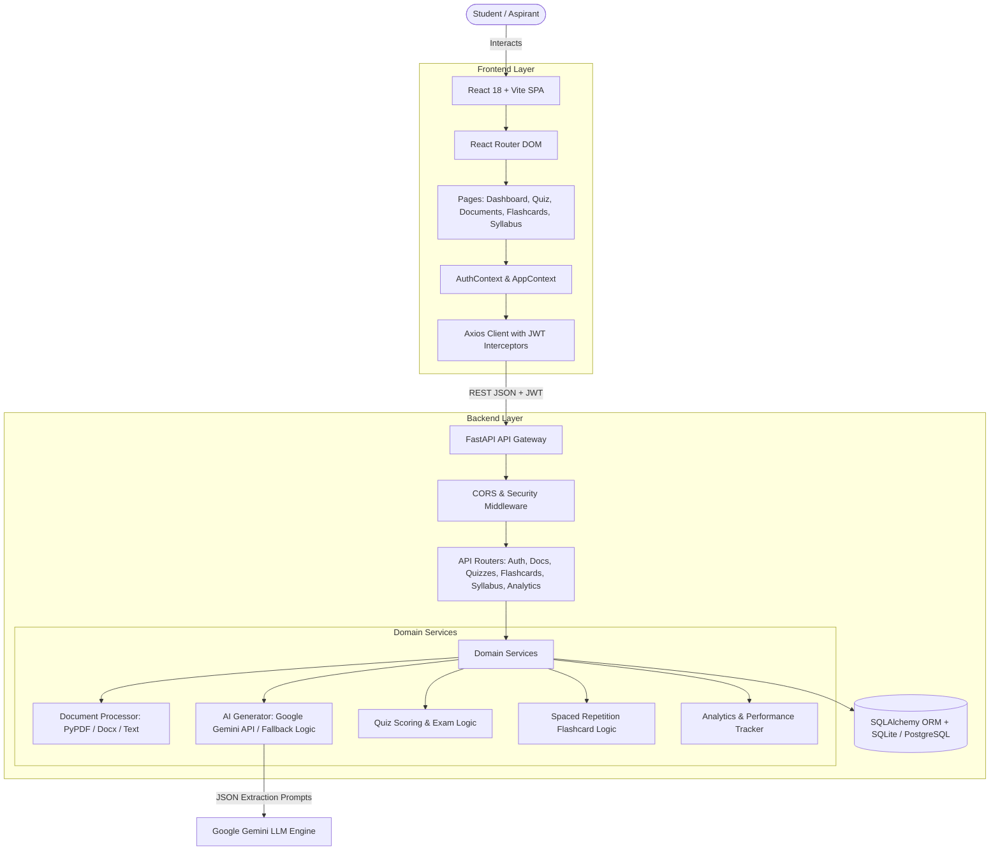

# BankPrepare AI — Architecture & Design

## 🏛️ System Architecture

---

## 🔑 Key Design Decisions

1. **FastAPI & Async Support**: Chosen for high throughput, automatic OpenAPI documentation, and native Pydantic schema validation.
2. **Modular Service Layer**: Business logic is separated into dedicated services (`document_processor.py`, `ai_generator.py`, `quiz_service.py`), allowing straightforward unit testing and replacement of AI providers.
3. **Structured Prompt Engineering**: Gemini prompts enforce strict JSON schemas for MCQ options, explanations, references, and difficulty levels, preventing parsing errors.
4. **Fallback Resilience**: When an external AI key is absent or offline, an intelligent heuristic question generator supplies banking test questions so users can test immediately.
5. **State Management in React**: Clean React Contexts (`AuthContext` and `AppContext`) paired with custom hooks (`useAuth`, `useApi`) ensure predictable UI state and token synchronization.
