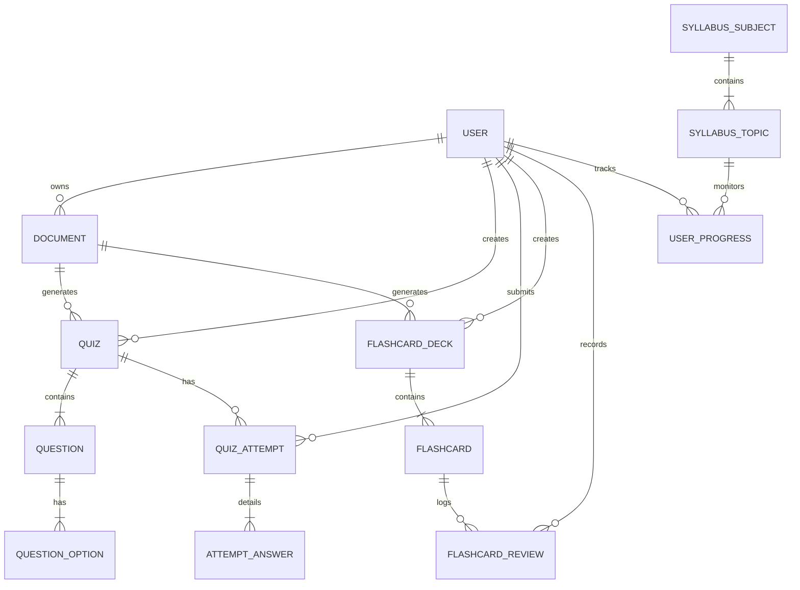

# BankPrepare AI — Database Schema & Data Models

## 🗄️ Entity-Relationship Diagram

---

## 📋 Table Specifications

### 1. `users`
- `id` (INTEGER, PK, Auto-increment)
- `email` (VARCHAR, Unique, Indexed)
- `hashed_password` (VARCHAR)
- `full_name` (VARCHAR)
- `target_exam` (VARCHAR) — e.g. "IBPS PO", "SBI Clerk", "RBI Grade B"
- `is_active` (BOOLEAN, Default: true)
- `created_at` (TIMESTAMP)
- `updated_at` (TIMESTAMP)

### 2. `documents`
- `id` (INTEGER, PK)
- `user_id` (INTEGER, FK -> users.id)
- `title` (VARCHAR)
- `file_path` (VARCHAR)
- `file_type` (VARCHAR: pdf, docx, txt)
- `file_size` (INTEGER)
- `extracted_text` (TEXT)
- `summary` (TEXT)
- `subject` (VARCHAR)
- `created_at` (TIMESTAMP)

### 3. `quizzes`
- `id` (INTEGER, PK)
- `user_id` (INTEGER, FK -> users.id)
- `document_id` (INTEGER, FK -> documents.id, Nullable)
- `title` (VARCHAR)
- `description` (TEXT)
- `subject` (VARCHAR)
- `topic` (VARCHAR)
- `difficulty` (VARCHAR: easy, medium, hard)
- `time_limit_minutes` (INTEGER)
- `negative_marking` (FLOAT, Default: 0.25)
- `total_marks` (FLOAT)
- `created_at` (TIMESTAMP)

### 4. `questions`
- `id` (INTEGER, PK)
- `quiz_id` (INTEGER, FK -> quizzes.id)
- `question_text` (TEXT)
- `question_type` (VARCHAR: mcq, true_false, fill_blank)
- `marks` (FLOAT, Default: 1.0)
- `negative_marks` (FLOAT, Default: 0.25)
- `explanation` (TEXT)
- `reference_note` (TEXT)
- `order_index` (INTEGER)

### 5. `question_options`
- `id` (INTEGER, PK)
- `question_id` (INTEGER, FK -> questions.id)
- `option_text` (TEXT)
- `is_correct` (BOOLEAN)
- `order_index` (INTEGER)

### 6. `quiz_attempts` & `attempt_answers`
- Tracks score, time taken, candidate response per question, correctness, and computed accuracy.

### 7. `flashcard_decks` & `flashcards`
- Front text, back explanation, subject, mastery level (0-5), next review interval.
